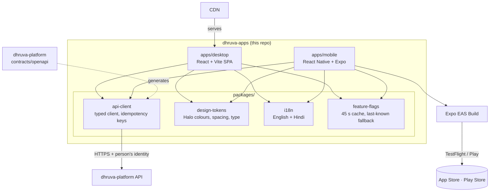

# dhruva-apps

All user-facing DhruvaOne applications in one monorepo: the **desktop web app** for role desktops and the **phone app** for parents, staff, students and bus attendants. They share one API client, design tokens, English and Hindi strings, and a feature-flag client.

| | |
|---|---|
| Stack | React 19 + Vite (desktop), React Native + Expo SDK 58 (phone), shared TypeScript packages, pnpm workspaces |
| Needed from | MVP (Oct–Dec 2026) |
| Releases | Desktop: static build served by the CDN. Phone: Expo EAS Build → TestFlight / Play internal testing → stores. These are separate pipelines from one repo. |
| Design docs | [Repositories and Technology Stack](https://github.com/Dhruva-One/dhruva-docs/blob/main/Technology/DhruvaOne%20Repositories%20and%20Technology%20Stack.md) · [Technical Architecture](https://github.com/Dhruva-One/dhruva-docs/blob/main/Technology/DhruvaOne-Technical-Architecture.md) |

## Purpose

- **Desktop:** role desktops for the owner, principal, academic coordinator, exam cell, HoD, accounts, HR and payroll, admissions, transport, security and IT, and counsellor.
- **Phone:** one app for every phone role, with profile switching. Each role opens on a short task list Dhruva has prepared, so most jobs take one tap.
- **Shared contract:** web and phone use the same API client, strings, tokens and flag logic, so they cannot drift.

## High-level architecture



### Rules for app code

| Rule | Why |
|---|---|
| Talk only to `dhruva-platform`, never to other services or databases | Permissions and feature switches are checked in one place |
| Use `@dhruva/api-client`; don't call `fetch` directly | One contract, generated from the platform's OpenAPI description |
| Every mutating call sends an `Idempotency-Key` (the client does this) | Phones retry on poor networks; the server replays the first result |
| Attendance and bus taps queue on the device and retry with the same key | Morning attendance and bus routes must survive network drops |
| Feature flags come from the platform, cached 30–60 s, with last-known values on failure | A flag outage must never block attendance |
| Every string goes through `t()` with English and Hindi | English and Hindi everywhere; Devanagari must render on low-end Android |
| Targets: iOS 15+, Android 8+, 3 GB RAM phones; WCAG 2.1 AA | From the mobile and cross-cutting specs |
| Signing keys, `.ipa`/`.aab` builds and store credentials are never committed | They live in a secrets manager and a private India-region archive bucket |

## Repository layout

| Path | Purpose |
|---|---|
| `apps/desktop/` | Vite SPA; `/api` is proxied to the platform in development |
| `apps/mobile/` | Expo app (`app.json` bundle ID `in.dhruvaone.app`, `eas.json` build profiles) |
| `packages/api-client/` | Platform API client |
| `packages/design-tokens/` | Halo design tokens |
| `packages/i18n/` | `t(key, locale)` with `en` and `hi` |
| `packages/feature-flags/` | Cached flag evaluation |
| `packages/navigation/` | Every role, screen and phone tab from the Functional Overview and spec Table 7-A, each tied to its requirement modules |
| `pnpm-workspace.yaml` | Workspace definition; also pins one React version for both apps |

## Run it locally

**Prerequisites:** Node.js 20 or later (`.nvmrc`) and pnpm 10 (`corepack enable`). For the phone app you also need the Expo Go app on your phone, or an Android emulator or iOS simulator.

For live data, start `dhruva-platform` first (see its README; it serves `http://localhost:3000`). Without it the apps still start and show "Platform: Not reachable".

```bash
pnpm install
```

### Desktop

```bash
cp apps/desktop/.env.example apps/desktop/.env
pnpm desktop                     # http://localhost:5173
```

You should see "Platform: Connected" and the demo tenant's campuses (Gurugram Sec 45, Noida Sec 30). Use the language button to switch to Hindi.

### Phone

```bash
pnpm mobile                      # starts Expo; scan the QR code with Expo Go
```

On a real phone, `localhost` is the phone itself. Set `expo.extra.platformUrl` in `apps/mobile/app.json` to your computer's LAN address, for example `http://192.168.1.20:3000`.

### Other commands

```bash
pnpm typecheck                   # all apps and packages
pnpm build:desktop               # production build to apps/desktop/dist
cd apps/mobile && npx expo export --platform android   # check the phone bundle builds
```

## Builds and releases (phone)

- `eas build --profile development` creates an internal development build.
- `eas build --profile staging` creates a staging build with its own bundle ID (`in.dhruvaone.app.staging`), so testers can install it next to production.
- `eas build --profile production` followed by `eas submit` sends the build to TestFlight and Play internal testing.
- Each build number maps to a git tag here, and release notes live in `dhruva-docs`. A copy of every `.ipa`/`.aab` goes to the private India-region archive bucket.
- There are no releases on exam days, pay days or a campus's first go-live week. Use staged rollout, and keep server-side feature switches ready to turn a feature off.

## Related repositories

`dhruva-platform` · `dhruva-ai` · `dhruva-site` · `dhruva-infra` · `dhruva-whatsapp` · `dhruva-connectors`, all in the [Dhruva-One](https://github.com/Dhruva-One) organisation.
